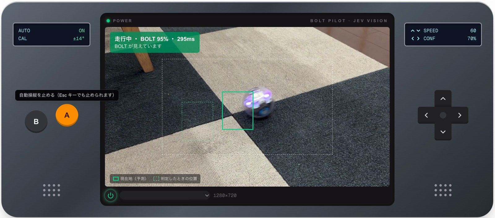
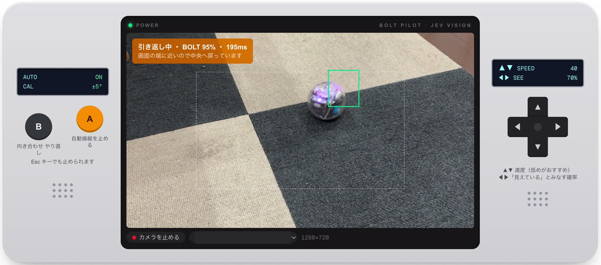

# BOLT Pilot

Sphero BOLT を、AI の目で自動操縦したり、手で操作したりする Web アプリです。
Web Bluetooth で BOLT に直接接続するので、公式アプリ（Sphero Edu）は使いません。
Mac につないだ iPhone のカメラを「目」にして、AI（TypeSafe Jev）がカメラ映像から BOLT の位置を判定し、
画面の外へ出ないように走らせます。



> **非公式プロジェクトです。** Sphero 社とは関係ありません。BOLT の通信仕様は公開されていないため、
> コミュニティによる解析結果（spherov2.py）をもとに実装しています。ファームウェアの更新などで
> 動かなくなる可能性があります。

## できること

画面は「自動操縦」と「手動操作」の 2 つで、タブで切り替えます。BOLT への接続は両方で共通です。
どちらも携帯ゲーム機のような見た目で、左右のグリップにボタン、中央に画面があります。

### 自動操縦



*画面の端に近づいたので、中央へ引き返しているところ。*

- **画面**：iPhone のカメラ映像に、BOLT の位置を示す 2 種類の枠と、引き返しを始める境界（点線の四角）を重ねて表示します。
  - 緑の実線の枠：Jev が判定した位置に、その後に出した走行命令で進む分を足した「予測した現在地」。
    BOLT をどちらへ向かわせようとしているかが分かります
  - 緑の点線の枠：Jev が判定に使ったコマでの位置（少し前の位置）
  左上に、状態・BOLT が写っている確率・応答時間が出ます。
- **左グリップ**：A ボタンで自動操縦の開始 / 停止、B ボタンで向き合わせのやり直し
- **右グリップ**：十字キーの ▲▼ で速度、◀▶ で「見えている」とみなす確率を変更
- **動き**
  - BOLT が写っている間はランダムに走り、画面の端（点線の外）に近づくと中央へ引き返します。
  - 見えなくなったら止まります。
  - 最初に BOLT を少しずつ走らせて、映像の中の方向と BOLT の向きを対応づけます（向き合わせ）。
- **BOLT のマトリクス**：自動操縦の状態をマークで表示します。
  | マーク | 状態 |
  |---|---|
  | 青い目（ときどきまばたき） | 判定待ち・探している |
  | 紫のくるくる | 向き合わせ中 |
  | 緑の矢印 | 走行中（矢印は BOLT の進む向きを指します） |
  | 黄色の U ターン | 画面の端から中央へ引き返し中 |
  | 赤の ✕ | 止まった・見失った |

  自動操縦を止めると消灯します。表示に失敗しても走行は続けます。
- **キーボード**：矢印キーで十字キーと同じ操作、**Esc キーで自動操縦を停止**

### 手動操作

- **左グリップ**：十字キーを押している間だけその方向に走ります（中央の赤いボタンで停止）。SPEED −/＋ で速度を変えます。
- **右グリップ**：A でマトリクス点灯、X で前 LED、Y で後 LED、B ですべて消灯。「現在の向きを正面にする」と、自動操縦のマークを順に表示する「マークを試す」もここにあります。
  十字キーの「上」で自分から離れる方向に進ませたいときは、後ろの LED（Y）が自分の側に来るように BOLT を置いてから「現在の向きを正面にする」を押します。
- **画面**：走行の向き（方位表示）と速度、ライトの色を表示します。ライトを押すと色を選べます。
- **BOLT のマトリクス**：走っている間は進む向きを指す緑の矢印（速いほど軸が長い）、止めると赤の四角を表示します。
  A（マトリクス点灯）や B（すべて消灯）を押すと表示は止まり、次に走らせたときにまた出ます。
- **キーボード**：矢印キーを押している間だけ走ります。**Space キーで停止**

### 共通

- BOLT への接続・切断、電池診断（電圧・BOLT 自身の判定・充電状態）、起こす (wake)
- 通信ログ（スリープ通知などの意味も表示）

## 動作環境

- **PC 版の Chrome または Edge**（Web Bluetooth が必要です）
  - Safari、Firefox、iPhone / iPad のブラウザでは動きません
- Node.js 20.9 以上
- Sphero BOLT（BOLT+ は画面が異なるため未対応）
- 自動操縦を使う場合
  - macOS の連係カメラが使える Mac と iPhone（同じ Apple アカウントでサインイン）
  - [TypeSafe](https://console.typesafe.ai/keys) の API キー

## 使い方

```bash
npm install
npm run dev
```

開発サーバは `127.0.0.1` だけで待ち受けます（同じネットワークの他の端末からは接続できません）。
自動操縦の API に認証がないため、意図的にこの設定にしています。

1. Chrome で http://localhost:3000 を開く
2. 上の「BOLT に接続」を押し、一覧から `SB-xxxx` を選ぶ
3. 「自動操縦」か「手動操作」のタブを選んで操作する

### 自動操縦を使う

1. プロジェクト直下に `.env.local` を作り、TypeSafe の API キーを書く（このファイルはコミットされません）

   ```
   TYPESAFE_API_KEY=your-api-key
   ```

2. 画面の左下の電源ボタンを押す（iPhone のカメラがあれば自動で選ばれます）
3. BOLT をカメラの中央付近に置き、A ボタン（自動操縦を開始）を押す
4. 最初に向き合わせ（6 秒ほど、前後左右に少しずつ動く）が行われ、その後に自動で走り始めます

最初は速度を低め（10〜40）にし、机から落ちない広い場所で試してください。

#### 仕組み

1. 0.3 秒おき以上の間隔で、カメラの 1 コマ（640×360 の JPEG）をサーバ側の `/api/vision` に送ります。
2. サーバが Jev（`jev-1.14.0`）に、1 回の問い合わせで次の 2 つを聞きます。
   - 「BOLT は写っているか」（`noul`：はい/いいえの確率）
   - 「BOLT はどこにあるか」（`box`：位置を示す枠）
3. **向き合わせ**：BOLT を 0° と 90° に 0.8 秒ずつ試走させ（毎回、逆向きに走って戻る）、
   映像の中でどちらへ動いたかを測ります。これで「映像の中で左へ進むには何度に走ればよいか」が計算できます。
   接続し直したときや、手動操作で正面をリセットしたときはやり直します。
4. **走行**：確率が基準（初期値 70%）以上なら、2 秒ごとに向きを変えながらランダムに走ります。
5. **引き返し**：画面の端から 20% の範囲に入ると、中央へ向かう向きに向け直して戻ります。
   端から 35% より内側に戻るまで続けます（入る線と出る線をずらして、行ったり来たりを防ぐ）。

#### 安全設計

- **止まる側に倒す設計です。** 次のどれでも停止します。
  - 確率が基準を下回った、または位置が当てにならない（枠の確信度が 30% 未満）
  - 通信や判定でエラーが起きた
  - 「写っている」という判定が 1.5 秒以上届かない（見張りタイマー）
- BOLT の切断、カメラの停止、手動操作への切り替えで、自動操縦も解除されます。
- API キーはサーバ側だけで使い、ブラウザには渡しません。`/api/vision` は同じオリジンからの呼び出しだけを受け付け、
  リクエストの大きさ（約 2.8MB まで）と呼び出し回数（1 秒あたり 5 回まで）を制限しています。
- **`/api/vision` にログインのような認証はありません。** Origin の確認は curl などでは偽装できるため、
  トンネルなどで外部に公開すると、他人に Jev の料金を使われるおそれがあります。
  ローカルでのみ使い、外部に公開する場合は先に認証を追加してください。

#### 既知の制約

- 判定の遅れ（実測で 0.2〜0.4 秒程度）の分だけ BOLT は先に進んでいます。
  緑の実線の枠は、出した走行命令（加速・向きを変える時間を含む）からその分を予測して補いますが、
  BOLT 本体と完全には重なりません。予測がどれだけ当たっているかは、自動操縦のログに 5 秒おきに出ます。
- 画面の端ぎりぎりでは、引き返しや停止が間に合わないことがあります。
- 向き合わせは映像の遠近を考えない簡易的な計算なので、カメラを斜めから向けるほど方向がずれます。

> Jev の画像入力は、TypeSafe 自身が「実験的機能で本番向けではない」としています
> （リクエストに `TypeSafe-Danger-Zone-Images: true` ヘッダーが必要）。

### うまく動かないとき

- **すぐにスリープする / コマンドがタイムアウトする**：電池切れの可能性があります。
  充電台に載せてから「電池を診断」で確認してください（満充電で約 4.2V）。
- **何も操作しないと約 8 分でスリープします。** 「起こす (wake)」を押すか、接続し直してください。
- **初回の接続で `No Services matching UUID` と出る**：もう一度接続すると成功することがあります。
- **開発中にコードを修正したら**、ページを再読み込みして接続し直してください。
  接続中のオブジェクトは修正前の定義のまま残ります。
- **カメラが映らない**：iPhone のロックを解除し、Chrome にカメラの使用を許可してください
  （システム設定 → プライバシーとセキュリティ → カメラ）。
- **向き合わせに失敗する**：試走で BOLT が画面の外に出たか、動きが小さすぎます。
  BOLT を画面の中央に置き直すか、速度を少し上げてください。
- **自動操縦で「TYPESAFE_API_KEY が設定されていません」と出る**：`.env.local` を確認し、反映されなければ開発サーバを再起動してください。

## 構成

| ファイル | 役割 |
|---|---|
| `lib/bolt/protocol.ts` | Sphero API v2 のパケットの組み立てと解析 |
| `lib/bolt/bolt.ts` | Web Bluetooth での接続と、BOLT の操作 API |
| `lib/bolt/matrix.ts` | マトリクスへのマーク表示（差分だけを送る描画、状態ごとのマーク） |
| `lib/autopilot/tracker.ts` | 判定の遅れを補う、BOLT の現在地の予測 |
| `lib/autopilot/geometry.ts` | 映像の中の方向と BOLT の向きを対応づける計算（向き合わせ） |
| `app/robot-app.tsx` | 画面全体（接続バー、タブ、通信ログ） |
| `app/connection-bar.tsx` | 共通の接続バー（接続・切断・電池診断・起こす） |
| `app/autopilot-tab.tsx` | 自動操縦の画面（カメラと映像上の表示） |
| `app/autopilot.tsx` | 自動操縦（判定ループ、向き合わせ、引き返し、見張りタイマー、操作部） |
| `app/manual-control.tsx` | 手動操作の画面 |
| `app/camera-view.tsx` | カメラ映像の表示 |
| `app/handheld/controls.tsx` | 携帯ゲーム機風の部品（本体、十字キー、ボタン、表示窓） |
| `app/api/vision/route.ts` | 画像を Jev に送って判定するサーバ側 API |

### 通信の概要

- BLE の UART 方式で、1 つの characteristic（`00010002-574f-4f20-5370-6865726f2121`）で送受信します。
- 接続直後に `00020005-…` へ `usetheforce...band` を書き込まないとコマンドを受け付けません。
- BOLT は 2 つのプロセッサを持ち、コマンドごとに送り先が決まっています。
  - `0x11`（primary）：電源、前後 LED
  - `0x12`（secondary）：走行、LED マトリクス、センサー
- マトリクスは BOLT の中の機械に載っていて、進む向きと一緒に回ります。0 行目の側が進む向きの後ろなので、絵は 180° 回して描きます。
- 電池残量（%）の取得コマンドには対応していません（`bad_command_id` が返ります）。

## 謝辞

通信プロトコルの実装は [spherov2.py](https://github.com/artificial-intelligence-class/spherov2.py)（MIT License）を
参考にしています。詳細は [THIRD_PARTY_NOTICES.md](./THIRD_PARTY_NOTICES.md) を参照してください。

## ライセンス

[MIT License](./LICENSE)

Sphero および Sphero BOLT は Sphero, Inc. の商標です。
